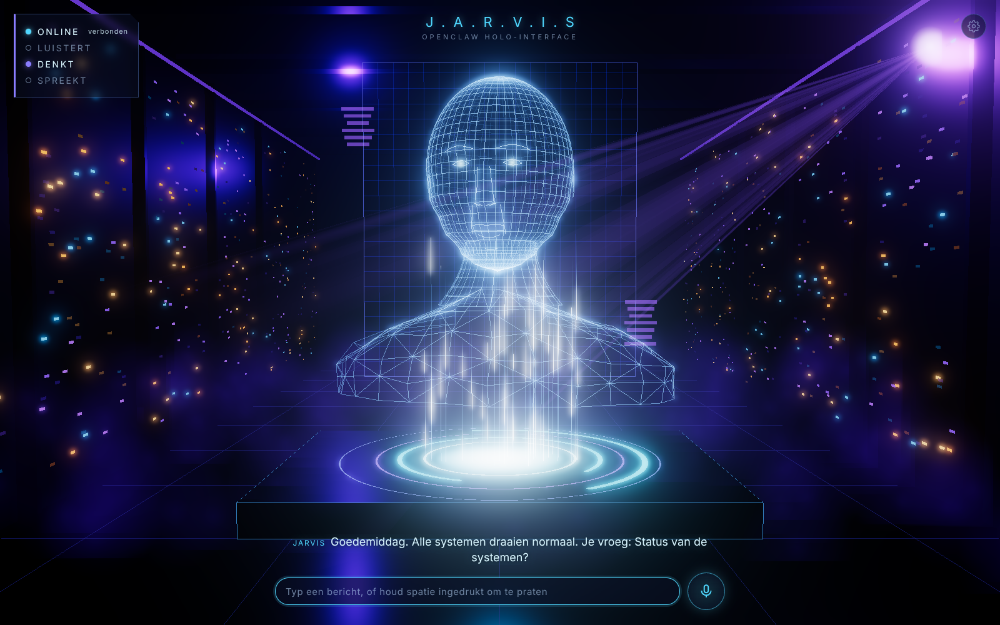

# J.A.R.V.I.S HUD voor OpenClaw

Een holografische 3D-interface voor je OpenClaw-assistent: een draadmodel-hoofd op een
gloeiend platform in een paarse serverruimte. Je praat via de microfoon van je browser,
Jarvis antwoordt hardop, en een klein statuspaneel laat zien of hij **online** is,
**luistert**, **denkt** of **spreekt**.



## Wat je nodig hebt

- OpenClaw met een draaiende Gateway op dezelfde machine (standaard `ws://127.0.0.1:18789`)
- Node.js 20 of nieuwer
- Chrome of Edge (voor spraakherkenning via de Web Speech API)

## Starten

```bash
cd hud
npm install
cp .env.example .env.local   # optioneel, zie hieronder
npm run dev
```

Open daarna http://localhost:5173.

### Verbinden met OpenClaw

De HUD heeft het Gateway-token nodig. Dat vraag je op met:

```bash
openclaw config get gateway.auth.token
```

Vul het token in via het tandwiel rechtsboven, of zet het in `.env.local` als
`VITE_OPENCLAW_TOKEN`. Je kunt het ook één keer meegeven in de URL:
`http://localhost:5173/?token=JOUW_TOKEN` (het wordt daarna uit de adresbalk gehaald).

Bij de eerste verbinding maakt de HUD een eigen apparaat-sleutel (Ed25519) aan. Omdat
de HUD op dezelfde machine draait als OpenClaw, keurt de Gateway dit apparaat
automatisch goed. Daarna bewaart de HUD het apparaat-token, zodat het gedeelde token
niet meer nodig is.

Draait de HUD op een **ander** apparaat dan OpenClaw? Dan vraagt de Gateway om
goedkeuring. De HUD toont dan het commando, bijvoorbeeld
`openclaw devices approve <requestId>`, dat je op de OpenClaw-machine uitvoert. Zet in
dat geval ook het adres van de HUD in `gateway.controlUi.allowedOrigins`.

## Bediening

| Actie | Hoe |
| --- | --- |
| Praten | Klik op de microfoonknop, of houd **spatie** ingedrukt |
| Typen | Typ in het invoerveld en druk op Enter |
| Jarvis onderbreken | Begin te praten, of druk op **Esc** |
| Instellingen | Tandwiel rechtsboven: Gateway-URL, token, taal, stem aan/uit |

## Hoe het werkt

```
Browser (HUD)                                    OpenClaw Gateway
─────────────                                    ────────────────
microfoon → Web Speech API → tekst ── chat.send ──▶  agent
luidspreker ◀ speechSynthesis ◀ tekst ◀── chat-events (delta/final)
three.js hologram reageert op: online · luistert · denkt · spreekt
```

- `src/gateway/` — WebSocket-client voor Gateway-protocol v4: `connect.challenge`,
  ondertekende `connect`, `chat.send` en `chat`-events, automatisch opnieuw verbinden.
- `src/voice/` — spraakherkenning, spraakuitvoer en een microfoon-niveaumeter.
- `src/scene/` — de three.js-scène: procedureel draadhoofd met bewegende kaak,
  platform met ringen, datastralen, serverkasten, nevel, lichtbundel en bloom.

## Prestaties

De scène is afgesteld op geïntegreerde grafische kaarten zoals de Intel UHD 620 in een
Lenovo ThinkPad T580: de pixelratio is begrensd op 1,5 en de bloom rendert op halve
resolutie.

## Scripts

- `npm run dev` — ontwikkelserver op poort 5173
- `npm run build` — typecheck en productie-build in `dist/`
- `npm run preview` — de build lokaal bekijken op poort 4173
